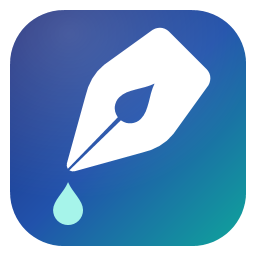
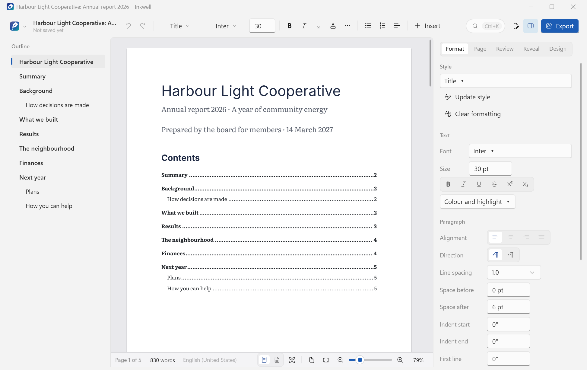
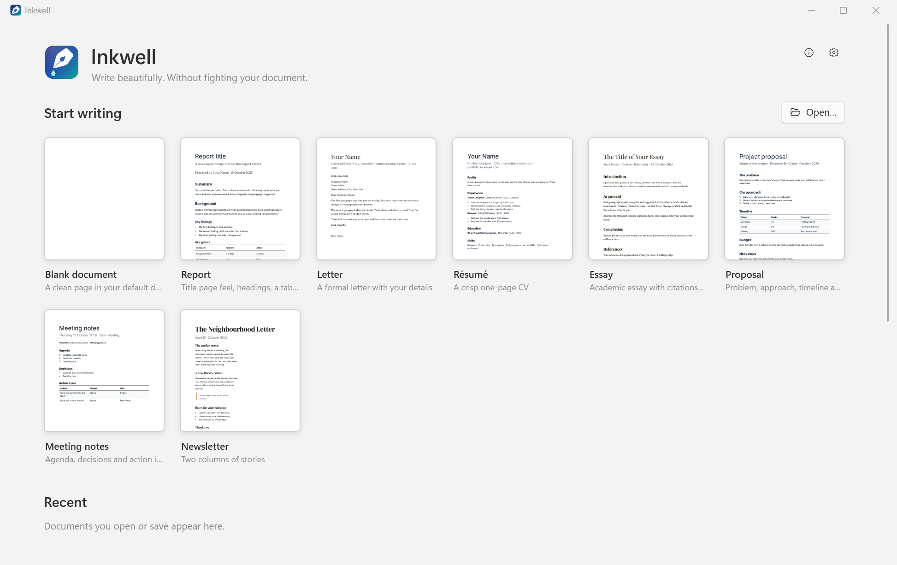
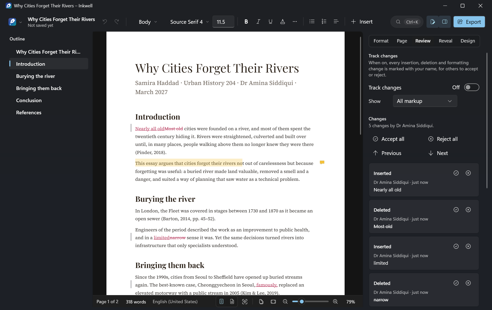
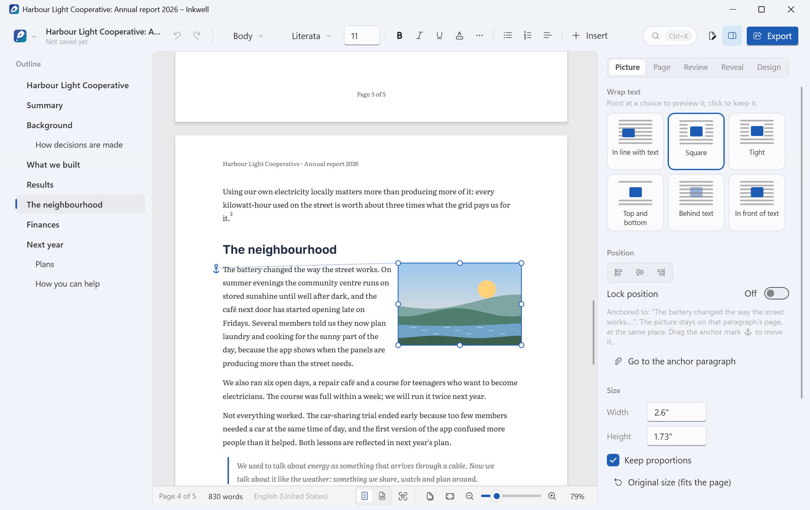
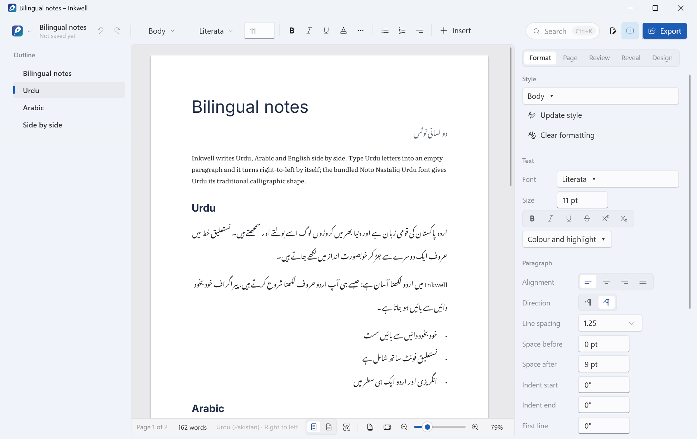

<p align="center"></p>

# Inkwell

**Write beautifully. Without fighting your document.**

Inkwell is a free word processor for Windows. It opens and saves Word documents (.docx) directly, looks like a modern Windows 11 app, and fixes the things that make word processors frustrating: pictures that jump, lists that number themselves wrongly, pastes that drag in someone else's fonts, mystery blank pages and autocorrect you can't undo.



| | |
|---|---|
|  |  |
|  |  |

## What Inkwell fixes

- **Pictures stay where you put them.** Clear wrap choices (in line, square, tight, top and bottom, behind, in front) that preview when you point at them, alignment guides while dragging, a visible anchor you can move, and **Lock position**. A picture you move keeps its place on the page when the text above it changes.
- **Lists number the way you expect.** A list continues only from the list right above it. **Restart at 1**, **Continue from the list above** and **Start at…** are right there in the panel (and on the right-click menu), and indents stay consistent.
- **Paste without the mess.** Pasted text takes your document's fonts and styles but keeps bold, italic, links, headings, lists and tables. A small chip offers **Keep source formatting** or **Text only**; Ctrl+Shift+V always pastes plain text.
- **See why text looks the way it does.** Reveal formatting (Shift+F1) lists each setting and where it comes from: the style, the style it's based on, the list, or formatting set directly on the text. **Clear formatting** is one click, and the style consistency check finds stray fonts, fake headings, typed-in lists and empty lines used for spacing, each with a one-click fix.
- **No mystery blank pages.** Page, column and section breaks are visible and labelled when formatting marks are on, and you can select and delete them. The empty paragraph Word requires after a final table never gets a page of its own, and a page break at the very end doesn't add a blank page.
- **Tables that cooperate.** Drag column borders, fit columns to their contents or the page, repeat the header row on every page, keep rows from splitting, add and delete rows and columns with one click; Tab in the last cell adds a row.
- **Autocorrect you can trust.** Every automatic change (smart quotes, dashes, ©, capitals…) shows a small chip with **Undo** and **Stop doing this**, and one Ctrl+Z straight after it undoes it, also when Enter made it. No capital letter after "i.e.", "e.g." or "etc.". Markdown shortcuts (`#`, `-`, `1.`, `>`, `**bold**`, `_italic_`, `` `code` ``) are each undone by a single Ctrl+Z too. Every rule, Markdown included, has its own switch in Settings › Autocorrect, so a rule you stopped from the chip can be turned back on.
- **Never lose work.** A .docx or .docm document that has a file saves itself a few seconds after you stop typing (safely: a new copy replaces the old one only when it's complete; Settings can turn this off). New documents get recovery copies, and version history keeps earlier versions you can browse, open or restore.
- **One landscape page, one click.** "Make this page landscape" adds the section breaks around the page for you.
- **Headers and footers without fiddling.** Click the top or bottom of a page to edit them. Different first page and different odd / even pages are switches, and page numbers are one click (the Page panel can make them "Page 3 of 10").
- **Styles that make sense.** A small, clear set (Title, Subtitle, Heading 1–3, Body, Quote, Caption, Code) that follows the document's design, and **Update style** to make a style look like the selection.
- **Counts you can rely on.** A live word count in the status bar (for the selection too, when there is one). Click it for characters, the count without footnotes and endnotes, reading and speaking time, and an optional word goal with a progress ring.

## Features

- **Word documents**: opens .docx, .docm, .dotx and .dotm (templates open as new documents) and saves .docx, or .docm to keep a document's macros, with styles, themes, lists, tables, pictures, headers and footers, sections, footnotes and endnotes, comments, tracked changes, fields and document properties. Parts Inkwell doesn't edit (macros, charts, SmartArt, equations, embedded objects, content controls, custom XML) are kept exactly as they were; in the text, charts, SmartArt, equations and embedded objects show as labelled placeholders and content controls show their content. When you open such a file Inkwell tells you what was kept. See the [compatibility table](#word-compatibility).
- **Other formats**: opens Markdown, plain text, RTF, OpenDocument text (.odt / .fodt) and web pages (as new documents to save as .docx). Exports PDF (text you can select and search in Latin, Greek, Cyrillic and Arabic script; bookmarks from headings; working links), Markdown, a web page and plain text. Prints through Windows.
- **Designs**: six designs (fonts, colours and heading styles at once) and eight templates: blank, report, letter, résumé, essay, proposal, meeting notes and newsletter. Bundled fonts include Literata, Source Serif 4, Inter, Playfair Display, DM Sans, JetBrains Mono, and Noto Naskh Arabic and Noto Nastaliq Urdu for right-to-left text. When it saves, Inkwell embeds the bundled fonts a document refers to (in its text, styles or design), so the document looks the same on a PC without them: 0.6–1.6 MB per document in the [samples](samples/). Settings can turn it off.
- **Typography**: kerning and ligatures, widow and orphan control, keep with next, smart quotes, proper dashes.
- **Writing**: focus mode (everything but the current paragraph fades, the line stays in the middle), typewriter scrolling, pageless view, word goals, dark mode with readable pages (or dark pages if you prefer).
- **Command palette** (Ctrl+K) for the commands, styles, designs, templates and headings; **slash commands** (type `/` for a table, heading, picture, contents, footnote, page break, quote, code, divider, date…).
- **Long documents**: table of contents (insert, update, click to jump), footnotes and endnotes, captions and cross-references, bookmarks, citations and bibliography in APA, MLA, Chicago and IEEE (kept in the .docx sources part, so Word sees them too).
- **Review**: comments with replies and resolve, track changes with All markup / Simple / No markup / Original, accept or reject one change, all changes, or all changes by one person.
- **Find and replace** with match case, whole words and regular expressions, in footnotes, comments, headers and footers too.
- **Spell checking** with Windows' own spell checker (Windows 8 and later, in the languages installed in Windows).
- **Right-to-left text**: start a paragraph in Urdu, Arabic or Hebrew and it turns right-to-left by itself; mixed English and Urdu lines keep the right order.
- **Accessibility**: keyboard shortcuts, the command palette and Alt+F for the menu, screen reader support for the document (UI Automation text pattern), alt text for pictures.
- **Automatic updates**, checked once a day (see [Updates](#updates)).

## Word compatibility

| In a .docx file | In Inkwell |
|---|---|
| Text, character and paragraph formatting, styles, theme fonts and colours | Shown and edited |
| Bulleted, numbered and multi-level lists, restart / continue numbering | Shown and edited |
| Tables: merged cells, borders, shading, header rows, rows that don't split | Shown and edited (borders are shown; table styles and shading are edited) |
| Pictures in line and floating (square, tight, top and bottom, behind, in front) | Shown and edited; tight wrapping is laid out like square |
| Headers and footers, different first page, different odd and even pages | Shown and edited |
| Sections: paper size, orientation, margins, columns; page, column and section breaks | Shown and edited |
| Hyperlinks, bookmarks | Shown and edited |
| Footnotes and endnotes | Shown and edited |
| Table of contents (TOC field) | Shown, inserted and updated |
| Captions (SEQ), cross-references (REF / PAGEREF), page numbers (PAGE / NUMPAGES) | Shown, inserted and updated |
| Citations and bibliography (CITATION / BIBLIOGRAPHY fields, sources part) | Shown, inserted and updated |
| Comments with replies, resolved comments | Shown and edited |
| Tracked insertions, deletions and formatting changes | Shown, made, accepted and rejected |
| Document properties (title, author, subject, keywords) | Shown and edited |
| Text boxes | Shown and kept; not edited |
| Content controls | Their content is shown and kept |
| Other fields | Their last result is shown; the field is kept |
| Charts, SmartArt, equations, embedded objects, EMF / WMF pictures | Kept exactly; shown as labelled placeholders |
| Macros (.docm), custom XML, glossary, digital signatures | Macros and custom XML are kept exactly; signatures are removed on save (they'd no longer match), as Word does |
| Word 97–2003 .doc files | Not supported: open them in Word and save as .docx |

**Checked against Microsoft Word:** nine documents saved by Inkwell (the five [samples](samples/) and tests of sections, lists, tables and fields) were opened in Microsoft Word (Microsoft 365, version 16) through its automation interface. All nine open without errors or repairs, and Word's counts match Inkwell's in 116 of 117 checks: pages, words, tables, pictures in line and floating, footnotes, endnotes, comments, sections, links, tables of contents, citation sources and tracked changes. The one difference: the résumé is two pages in Inkwell and one in Word, because a line next to the floating portrait wraps one word earlier in Inkwell. Line breaks can differ slightly from Word's, most likely next to floating pictures. To repeat the comparison (Word installed but not running): `INKWELL_FIDELITY_DIR=<folder> dotnet test --filter WordFidelityTests.WriteDocuments` writes the documents, then `tools\word-fidelity.ps1 -Folder <folder>` opens them in Word, read-only and invisible, and compares the counts.

## Download

| Edition | For | Installer |
|---|---|---|
| x64 | Windows 10 / 11, 64-bit Intel or AMD (most PCs) | [Inkwell-Setup-1.0.0-x64.exe](https://github.com/MuhammadNoman76/Inkwell/raw/refs/heads/main/release/Inkwell-Setup-1.0.0-x64.exe) (46.8 MB) |
| ARM64 | Windows 10 / 11 on ARM (Snapdragon, Surface Pro X…) | [Inkwell-Setup-1.0.0-arm64.exe](https://github.com/MuhammadNoman76/Inkwell/raw/refs/heads/main/release/Inkwell-Setup-1.0.0-arm64.exe) (41.6 MB) |
| x86 | 32-bit Windows 10 | [Inkwell-Setup-1.0.0-x86.exe](https://github.com/MuhammadNoman76/Inkwell/raw/refs/heads/main/release/Inkwell-Setup-1.0.0-x86.exe) (43.0 MB) |
| Windows 7 / 8.1 | Windows 7 SP1 and 8.1, 32- or 64-bit (needs .NET Framework 4.8) | [Inkwell-Setup-1.0.0-win7-8.exe](https://github.com/MuhammadNoman76/Inkwell/raw/refs/heads/main/release/Inkwell-Setup-1.0.0-win7-8.exe) (6.7 MB) |

Checksums: [SHA256SUMS.txt](https://github.com/MuhammadNoman76/Inkwell/blob/main/release/SHA256SUMS.txt). Download page: https://www.nomanshafiq.com/inkwell/

The installer can install for everyone (asks for administrator rights) or just for you. It offers to add Inkwell to the **Open with** list for .docx and .md files; it never makes itself the default app, so Word (or whatever you use) keeps opening your documents on double-click.

**Windows SmartScreen:** the installers aren't code-signed yet, so Windows may show "Windows protected your PC" the first time. Click **More info**, then **Run anyway**. You can check the download against `SHA256SUMS.txt` first.

**Not tested yet:** ARM64 hardware (the ARM64 edition is built but hasn't run on a real ARM PC), real Windows 7 / 8.1 PCs and 32-bit Windows 10 (those editions were run on 64-bit Windows 11), printing on a real printer, spell checking in languages other than English, screen readers (Narrator, NVDA) and East Asian input methods.

## Updates

Inkwell checks for a new version about 10 seconds after it starts and then at most once a day (a check that fails is tried again about an hour later). When there is one, it offers **Update now**, **Later** or **Skip this version**. Update now first asks about documents with unsaved changes, then downloads the installer for your edition, checks its size and SHA-256 checksum, installs it quietly (an install for everyone asks for administrator rights) and starts Inkwell again. A copy that wasn't installed with the installer gets the download page instead. Settings can turn the daily check off, and **Check now** there looks right away.

## Privacy

Inkwell works offline. It goes online only for updates: the update check downloads a small file (`https://www.nomanshafiq.com/updates/inkwell.json`) to see whether there is a new version, and **Update now** downloads the installer it lists. Settings can turn the check off. Clicking a link in a document opens it in your browser. Nothing about you or your documents is sent anywhere, and there is no telemetry.

Settings and recent files are kept in `%APPDATA%\Inkwell`. Version history, recovery copies and start-screen thumbnails are kept in `%LOCALAPPDATA%\Inkwell` (version history has a size limit you can change in Settings). A downloaded update waits in `%TEMP%\Inkwell-Update` and is deleted the next time Inkwell starts.

**Logs:** for troubleshooting, Inkwell writes two text files in `%APPDATA%\Inkwell`: `error.log` (unexpected errors: what Inkwell was doing, the error message and where in Inkwell's code it happened, sometimes with the path of the file involved) and `info.log` (the paths of the documents you open and export). Each starts over when it passes about 1 MB. They stay on your PC: Inkwell never sends them anywhere, and you can delete them at any time (Settings › Open the settings folder).

## Keyboard

| Keys | |
|---|---|
| Ctrl+K | Command palette |
| Alt+F | Menu |
| / at the start of a word | Slash commands |
| Ctrl+B / I / U | Bold / italic / underline |
| Ctrl+Space | Clear character formatting |
| Shift+F1 | Reveal formatting |
| Ctrl+Shift+C | Copy formatting (format painter) |
| Ctrl+Shift+V | Paste text only |
| Ctrl+Alt+1 / 2 / 3, Ctrl+Shift+N | Heading 1 / 2 / 3, body text |
| Ctrl+Shift+L | Bullets |
| Tab / Shift+Tab | List level down / up (at the start of a list item); next / previous table cell |
| Ctrl+Enter, Shift+Enter, Ctrl+Shift+Enter | Page break, line break, column break |
| Ctrl+Shift+K | Insert or edit a link (Ctrl+click follows one) |
| Ctrl+Alt+F / Ctrl+Alt+D | Footnote / endnote |
| Ctrl+Alt+M | Comment |
| Ctrl+Shift+E | Track changes on / off |
| Ctrl+F / Ctrl+H | Find / replace |
| F7 | Next spelling mistake |
| F9 | Update fields (contents, captions, references) |
| F11 | Focus mode |
| Ctrl+Shift+8 | Formatting marks |
| Ctrl+Shift+G | Word count |
| Ctrl+Alt+= / Ctrl+Alt+- | Zoom in / out (Ctrl + mouse wheel too) |
| Ctrl+0 | Fit page width |
| Ctrl+S, Ctrl+Shift+S, Ctrl+P | Save, save as, print |
| Ctrl+Shift+X | Export (PDF, Markdown, web page, text) |

Keys are named as on a US keyboard; menus, tooltips and the command palette show the names of your keyboard layout (Ctrl+Alt+= is Ctrl+Alt++ on a German keyboard, for example).

## Command line

```
Inkwell.exe [file …]                     open documents (up to 8 at a time)
Inkwell.exe --export-pdf <in> <out.pdf>  convert a document to PDF without opening a window
Inkwell.exe --settings                   open Settings
```

## Building

Requirements: Windows, the [.NET 10 SDK](https://dot.net) and [Inno Setup 6](https://jrsoftware.org/isdl.php) for the installers.

```powershell
powershell -ExecutionPolicy Bypass -File build.ps1                 # tests, every edition, installers
powershell -ExecutionPolicy Bypass -File build.ps1 -Editions x64   # one edition: x64, arm64, x86 or legacy (Windows 7 / 8.1)
powershell -ExecutionPolicy Bypass -File build.ps1 -SkipInstaller  # apps only, in publish\<edition>
dotnet test tests\Inkwell.Tests                                     # the tests (.NET 10 and .NET Framework 4.8)
```

`-Version X.Y.Z` sets the version (the default is the current one) and `-SkipTests` skips the tests. Output: `dist\Inkwell-Setup-<version>-<edition>.exe` (the legacy edition's file ends in `-win7-8`) and `dist\SHA256SUMS.txt`, copied to `release\` when every edition is built and each installer is under GitHub's 100 MB limit.

One C#/WPF codebase for .NET 10 (Windows 10 / 11, self-contained) and .NET Framework 4.8 (Windows 7 / 8.1):
- `src/Inkwell.Core`: the engine. A document model close to WordprocessingML, the style engine, .docx reading and writing that keeps what it doesn't understand, the layout engine (WPF's TextFormatter for line breaking, shaping and bidirectional text; Inkwell's own pagination with keep-with-next, widow and orphan control, tables across pages, footnotes, floating pictures and columns), page rendering, editing with undo, and the other formats (Markdown, HTML, text, RTF, ODT, PDF).
- `src/Inkwell`: the app (editor, panels, dialogs, start screen, settings, updates).
- `tests/Inkwell.Tests`: xUnit tests, run on both .NET versions: the engine, and checks of the app (every keyboard shortcut is unique and matches the menus, tooltips and the table above; the updater finds the installer's AppId; the autocorrect settings).
- `samples/`: the demo documents (made by the tests) and their PDFs.
- `tools/`: scripts that download and verify the fonts (`get-fonts.ps1`), generate the icon geometry from Fluent UI System Icons (`make-icons.mjs`), render the app icons (`make-icon.ps1`), and compare documents with Microsoft Word (`word-fidelity.ps1`, optional).

## Credits

- Fonts: Literata, Source Serif 4, Inter, Playfair Display, DM Serif Display, DM Sans, Plus Jakarta Sans, Space Grotesk, JetBrains Mono, Noto Naskh Arabic and Noto Nastaliq Urdu, under the SIL Open Font License 1.1.
- Icons: [Fluent UI System Icons](https://github.com/microsoft/fluentui-system-icons) by Microsoft (MIT).
- [Open XML SDK](https://github.com/dotnet/Open-XML-SDK) (MIT) for .docx files, [PDFsharp](https://www.pdfsharp.com) (MIT) for PDF export and [Markdig](https://github.com/xoofx/markdig) (BSD-2-Clause) for Markdown.

Full licence texts are in [THIRD-PARTY-NOTICES.txt](THIRD-PARTY-NOTICES.txt) and in Inkwell's About box. Inkwell is an independent project, not affiliated with Microsoft. Microsoft Word is a trademark of Microsoft Corporation.
